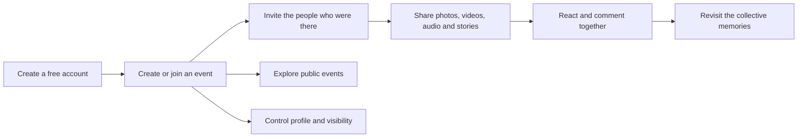
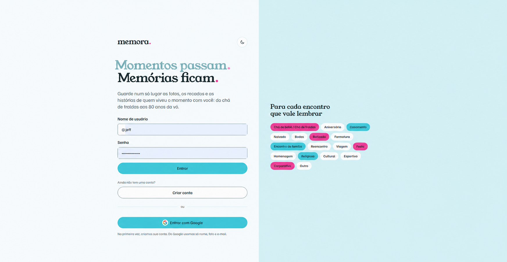
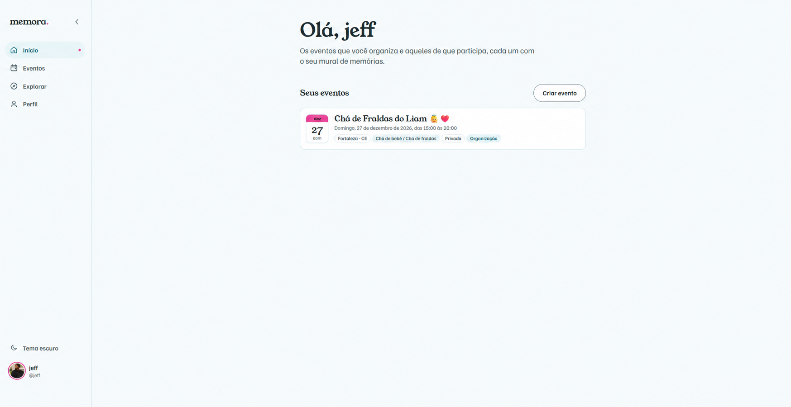
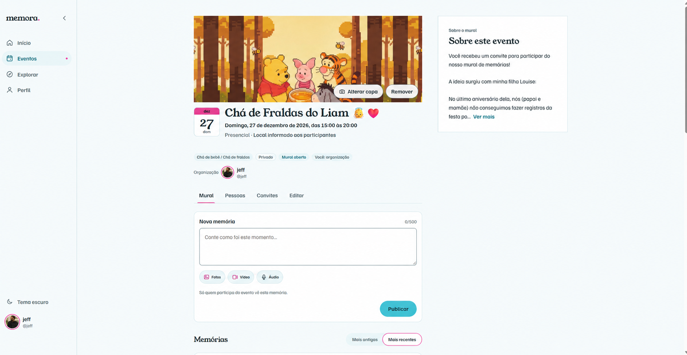
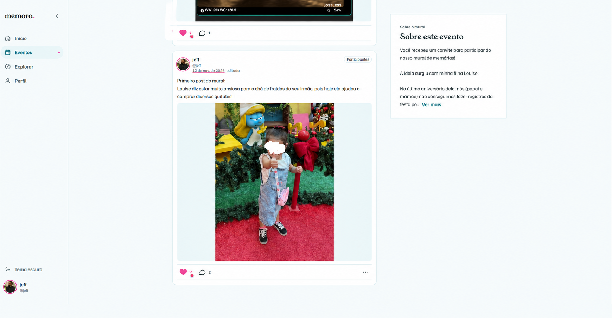
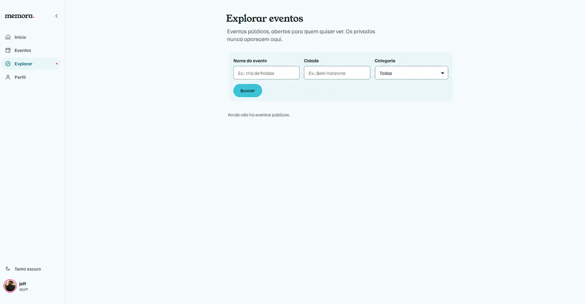
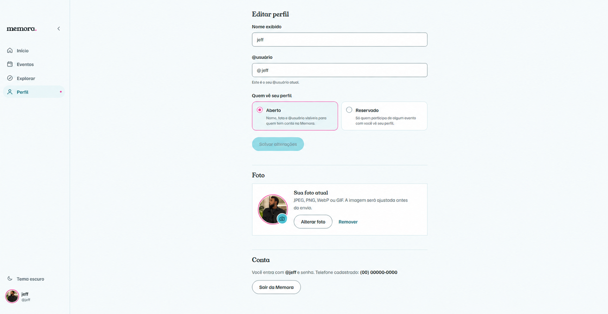

# Memora

> Moments pass. Memories remain.

Memora is a social platform for collecting the photos, videos, audio and stories that people create around shared events. Organizers can manage participation and invitations; guests can contribute memories and continue the conversation through comments, mentions and reactions.

[Português (Brasil)](README.pt-BR.md) · [Join Memora](https://memora-social.com.br)

> The live link is provided only as a product demonstration. This repository's development configuration never points to the production API, database or object storage.

> **Want to participate? Visit [memora-social.com.br](https://memora-social.com.br). Creating an account is free — and always will be.**

## The idea behind Memora

The person organizing an important event cannot always capture everything while making it happen. Memora turns each event into a collaborative memory wall: guests help preserve the moment with photos, videos, audio and messages, then keep those memories alive through reactions and comments. What would otherwise be scattered across different phones becomes a shared record that everyone who took part can revisit in the future.

## How the experience flows



## Product tour

<table>
  <tr>
    <td width="50%" valign="top">
      <strong>1. Join in the way that works for you</strong><br><br>
      Create a free account, sign in locally or continue with Google. The entry page also shows the kinds of moments the platform can preserve.<br><br>
      
    </td>
    <td width="50%" valign="top">
      <strong>2. Find every shared event in one place</strong><br><br>
      The home panel brings together events you organize and events you participate in, with their date, category, privacy and your role.<br><br>
      
    </td>
  </tr>
  <tr>
    <td width="50%" valign="top">
      <strong>3. Turn an event into a collaborative wall</strong><br><br>
      Organizers define the event, its story and visibility. Participants contribute text, photos, videos and audio to the same contextual timeline.<br><br>
      
    </td>
    <td width="50%" valign="top">
      <strong>4. Preserve and enrich each memory</strong><br><br>
      Memories keep their author and media together. Participants can react and comment, turning isolated files into a shared account of the moment.<br><br>
      
    </td>
  </tr>
  <tr>
    <td width="50%" valign="top">
      <strong>5. Discover public events</strong><br><br>
      Public events can be found by name, city and category. Private events never appear in discovery and remain governed by their access rules.<br><br>
      
    </td>
    <td width="50%" valign="top">
      <strong>6. Keep identity and privacy under control</strong><br><br>
      Each person manages their display identity, photo and profile visibility, choosing between a broader presence and an event-only profile.<br><br>
      
    </td>
  </tr>
</table>

## What this repository shows

- Local and Google sign-in, session security, CSRF protection and onboarding.
- Public, private and invitation-based events with participant roles.
- Invitations, join requests, attendance and organizer controls.
- Memories with image, audio and video processing.
- Comments, mentions, emoji reactions and engagement summaries.
- Structured Problem Details errors and responsive React interfaces.
- Versioned PostgreSQL migrations and integration tests with Testcontainers.

## Architecture

Memora is a modular monolith: a Java 21 / Spring Boot 3 API and a React 19 / TypeScript single-page application. PostgreSQL stores transactional data and S3-compatible object storage keeps media. The frontend uses React Router and TanStack Query.

```text
Browser (React) -> Spring Boot API -> PostgreSQL
                         |
                         +---------> S3-compatible storage
```

See [Architecture](docs/architecture.md), [Domain model](docs/domain-model.md) and [Technical decisions](docs/technical-decisions.md) for the deeper design.

## Run locally

Prerequisites: Java 21, Maven 3.9+, Node.js 22+, npm and Docker.

```bash
docker compose up -d postgres minio

mvn -f backend/pom.xml spring-boot:run

npm --prefix frontend ci
npm --prefix frontend run dev
```

The defaults use only local endpoints: web at `http://localhost:3000`, API at `http://localhost:8080`, PostgreSQL at `127.0.0.1:5434` and MinIO at `127.0.0.1:9000`. Create the `memora-local` bucket before testing uploads. OAuth remains disabled unless local credentials are supplied.

Complete setup and validation commands are in [Local development](docs/local-development.md).

## Validate

```bash
mvn -B -f backend/pom.xml verify
npm --prefix frontend test -- --run
npm --prefix frontend run build
```

The current showcase contains 102 backend unit tests, 125 backend integration tests and 107 frontend tests.

## Security and public scope

This is a curated, sanitized snapshot assembled from private development repositories. It intentionally excludes production credentials, deployment automation, infrastructure identifiers, user data, logs, backups and private Git history. Checked-in credentials are conspicuous local-only placeholders.

Read [Security overview](docs/security-overview.md) before adapting the project. Please report suspected vulnerabilities privately to the repository owner rather than opening a public issue.

## Repository layout

```text
backend/      Spring Boot API, migrations and tests
frontend/     React application and tests
docs/         Architecture, domain and security notes
compose.yaml  Local PostgreSQL and MinIO services
```

## License

No open-source license is granted. All rights are reserved unless a license is added explicitly.
