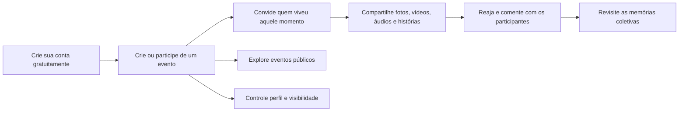
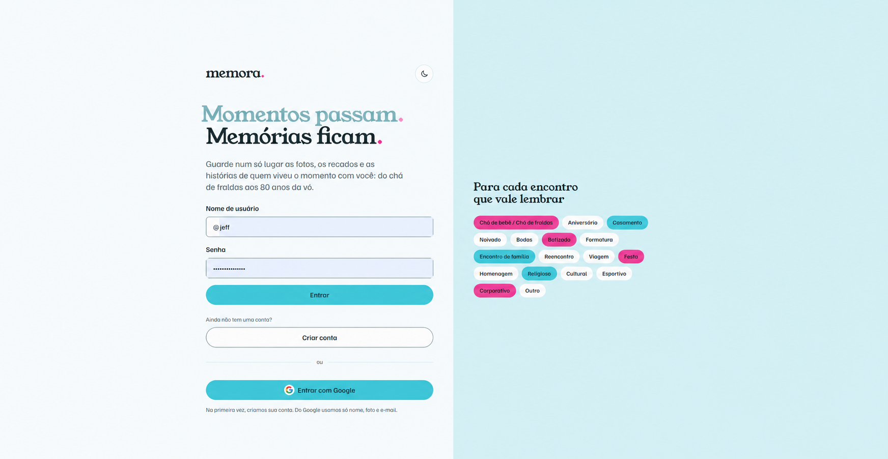
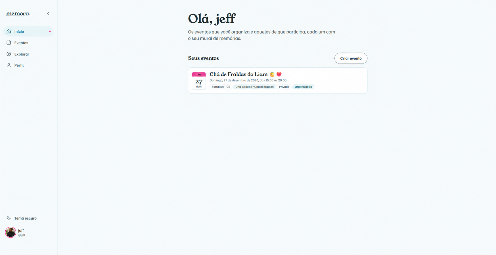
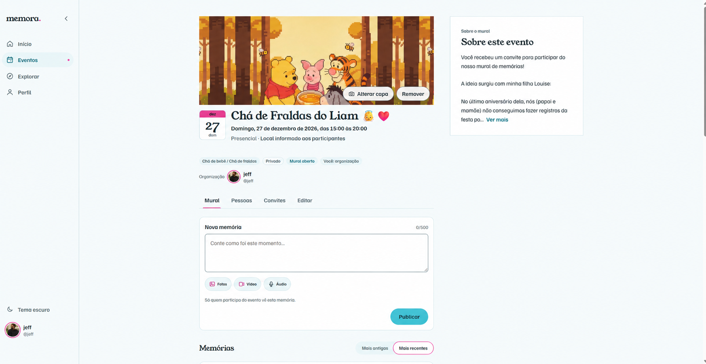
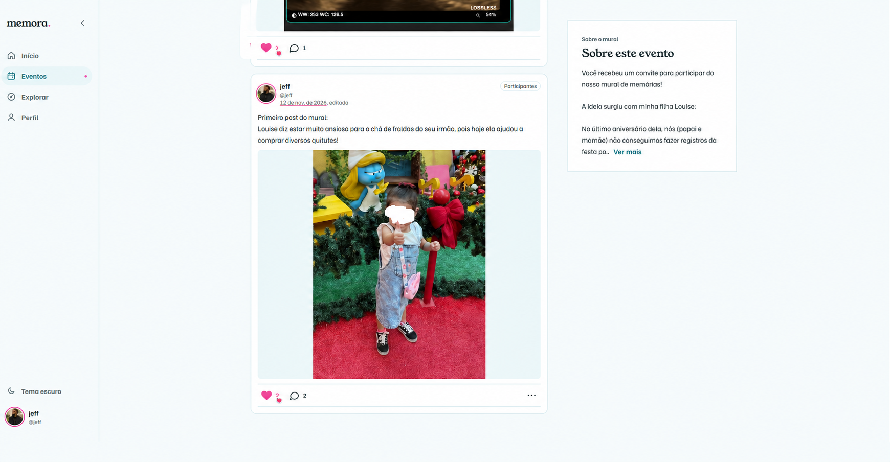
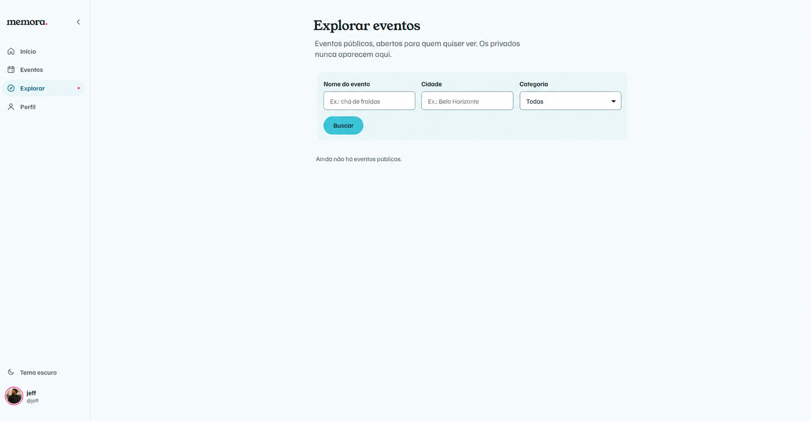
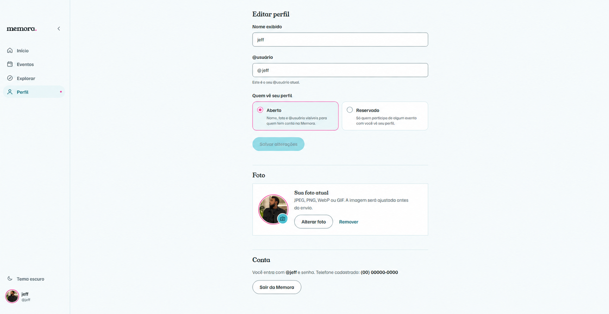

# Memora

> Momentos passam. Memórias ficam.

O Memora é uma plataforma social para reunir fotos, vídeos, áudios e histórias criadas em torno de eventos compartilhados. Organizadores gerenciam participantes e convites; convidados contribuem com memórias e continuam a conversa por comentários, menções e reações.

[English](README.md) · [Participar da Memora](https://memora-social.com.br)

> O link público serve apenas como demonstração do produto. A configuração de desenvolvimento deste repositório nunca aponta para API, banco ou armazenamento de produção.

> **Quer participar? Acesse [memora-social.com.br](https://memora-social.com.br). O cadastro é gratuito — e sempre será.**

## A ideia por trás da Memora

Quem organiza um momento importante nem sempre consegue registrar tudo enquanto faz o evento acontecer. A Memora transforma cada evento em um mural colaborativo: os convidados ajudam a preservar a ocasião com fotos, vídeos, áudios e mensagens, e mantêm essas lembranças vivas por meio de reações e comentários. O que ficaria espalhado em diferentes celulares se torna um registro compartilhado, que poderá ser revisitado no futuro por todos que participaram.

## Como a experiência funciona



## Conheça o produto

<table>
  <tr>
    <td width="50%" valign="top">
      <strong>1. Entre do jeito que preferir</strong><br><br>
      Crie uma conta gratuita, entre com usuário e senha ou continue com o Google. A entrada também apresenta os tipos de momentos que a plataforma pode preservar.<br><br>
      
    </td>
    <td width="50%" valign="top">
      <strong>2. Encontre todos os eventos em um só lugar</strong><br><br>
      O painel inicial reúne eventos que você organiza e aqueles dos quais participa, mostrando data, categoria, privacidade e seu papel.<br><br>
      
    </td>
  </tr>
  <tr>
    <td width="50%" valign="top">
      <strong>3. Transforme um evento em mural colaborativo</strong><br><br>
      A organização define o evento, sua história e visibilidade. Participantes contribuem com textos, fotos, vídeos e áudios na mesma linha do tempo contextualizada.<br><br>
      
    </td>
    <td width="50%" valign="top">
      <strong>4. Preserve e enriqueça cada memória</strong><br><br>
      As memórias mantêm autoria e mídia reunidas. Participantes podem reagir e comentar, transformando arquivos isolados em um relato compartilhado daquele momento.<br><br>
      
    </td>
  </tr>
  <tr>
    <td width="50%" valign="top">
      <strong>5. Descubra eventos públicos</strong><br><br>
      Eventos públicos podem ser encontrados por nome, cidade e categoria. Eventos privados nunca aparecem na busca e continuam protegidos por suas regras de acesso.<br><br>
      
    </td>
    <td width="50%" valign="top">
      <strong>6. Mantenha identidade e privacidade sob controle</strong><br><br>
      Cada pessoa gerencia nome, foto e visibilidade do perfil, escolhendo entre uma presença mais aberta e um perfil reservado a participantes de eventos em comum.<br><br>
      
    </td>
  </tr>
</table>

## O que este repositório demonstra

- Login local e Google, sessão segura, proteção CSRF e onboarding.
- Eventos públicos, privados ou por convite, com papéis de participante.
- Convites, solicitações de entrada, presença e controles de organização.
- Memórias com processamento de imagens, áudios e vídeos.
- Comentários, menções, reações com emoji e resumos de engajamento.
- Erros estruturados com Problem Details e interfaces React responsivas.
- Migrações PostgreSQL versionadas e testes de integração com Testcontainers.

## Arquitetura

O Memora é um monólito modular: API Java 21 / Spring Boot 3 e aplicação React 19 / TypeScript. O PostgreSQL guarda dados transacionais e um armazenamento compatível com S3 mantém as mídias. O frontend usa React Router e TanStack Query.

Consulte [Arquitetura](docs/architecture.md), [Modelo de domínio](docs/domain-model.md) e [Decisões técnicas](docs/technical-decisions.md) para conhecer o desenho em detalhes.

## Execução local

Pré-requisitos: Java 21, Maven 3.9+, Node.js 22+, npm e Docker.

```bash
docker compose up -d postgres minio

mvn -f backend/pom.xml spring-boot:run

npm --prefix frontend ci
npm --prefix frontend run dev
```

Os padrões usam somente endereços locais: web em `http://localhost:3000`, API em `http://localhost:8080`, PostgreSQL em `127.0.0.1:5434` e MinIO em `127.0.0.1:9000`. Crie o bucket `memora-local` antes de testar uploads. O OAuth permanece desativado enquanto credenciais locais não forem fornecidas.

O passo a passo completo está em [Desenvolvimento local](docs/local-development.md).

## Validação

```bash
mvn -B -f backend/pom.xml verify
npm --prefix frontend test -- --run
npm --prefix frontend run build
```

O showcase atual contém 102 testes unitários de backend, 125 testes de integração de backend e 107 testes de frontend.

## Segurança e escopo público

Este é um recorte selecionado e sanitizado, montado a partir de repositórios privados de desenvolvimento. Credenciais de produção, automações de deploy, identificadores de infraestrutura, dados de usuários, logs, backups e histórico Git privado foram deliberadamente excluídos. As credenciais versionadas são placeholders evidentes e exclusivos para uso local.

Leia a [Visão geral de segurança](docs/security-overview.md) antes de adaptar o projeto. Comunique possíveis vulnerabilidades em particular ao proprietário do repositório, sem abrir uma issue pública.

## Estrutura

```text
backend/      API Spring Boot, migrações e testes
frontend/     Aplicação React e testes
docs/         Notas de arquitetura, domínio e segurança
compose.yaml  Serviços locais PostgreSQL e MinIO
```

## Licença

Nenhuma licença de código aberto foi concedida. Todos os direitos estão reservados até que uma licença seja adicionada explicitamente.
