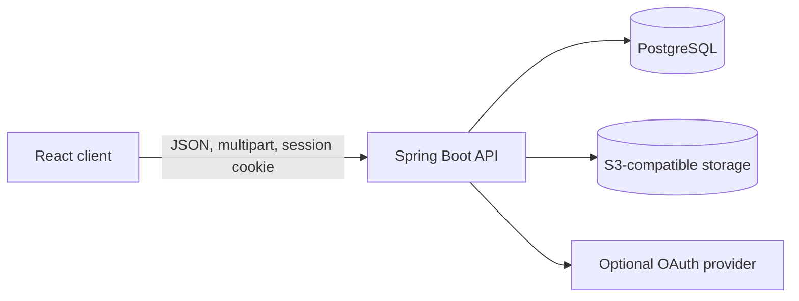
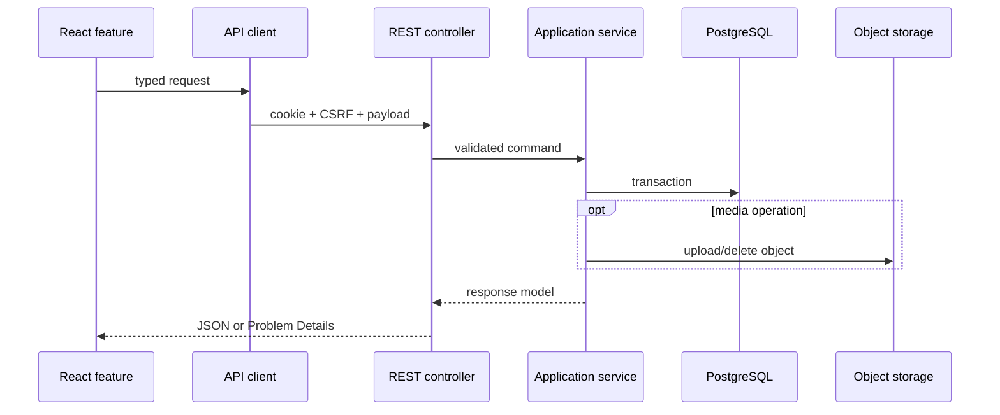

# Architecture

Memora is a modular monolith with a Spring Boot API and a React single-page application. The public repository keeps the product boundaries and executable behavior while replacing operational configuration with local-only examples.

## Backend

The backend is organized by business capability rather than technical layer alone:

- `identity`: local and OAuth sign-in, session security and account state.
- `profile`: onboarding, public identity and managed profile images.
- `event`: event lifecycle, discovery, visibility and covers.
- `membership`: participants, invitations, requests and attendance.
- `memory`: posts and image, audio or video attachments.
- `interaction`: comments, mentions, reactions and engagement summaries.
- `notification`: an application boundary for product notifications.
- `shared`: errors, security primitives, storage, media inspection and common API types.

Each capability may contain `domain`, `application`, `api` and persistence adapters. Cross-module access is kept explicit through application services and shared identifiers. Flyway owns the relational schema and Hibernate validates it at startup.

## Frontend

The frontend uses feature folders that mirror the API capabilities. TanStack Query owns server state, React Router defines public and authenticated routes, and the API client centralizes cookies, CSRF handling and Problem Details errors. Browser media preparation is isolated in `lib` and feature-specific components.

## Request flow

## Repository scope

This is a selected, sanitized engineering showcase. Deployment automation, production environment values, infrastructure identifiers, runtime data and private Git history are deliberately absent.
