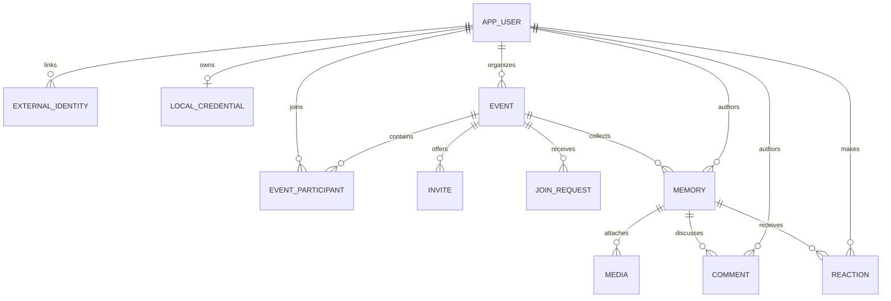

# Domain model

The model centers on events: people organize or join an event, contribute memories, and interact around those memories.

## Important invariants

- Usernames are normalized and unique.
- Account status and onboarding state gate protected operations.
- Every event has one organizer; participant roles control management operations.
- Event privacy and membership determine visibility and contribution rights.
- Invite tokens are stored as hashes, not as reusable plaintext values.
- Memory media has an explicit kind, metadata and storage lifecycle.
- A person has at most one reaction of a given kind for the same memory.
- Optimistic versions protect mutable aggregate state from lost updates.

The migrations under `backend/src/main/resources/db/migration` are the executable definition of the relational model.
